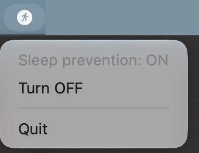
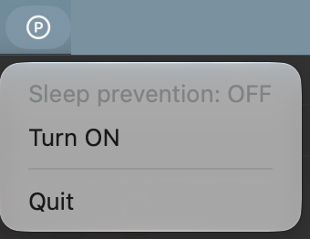

# pmsetly

 

> **English summary** — A tiny macOS menu bar app that toggles `pmset disablesleep`, so your Mac keeps
> running (AI agents, long builds) even with the lid closed. The whole app is 111 lines with no
> dependencies, small enough to read before you install. Build from source:
> `./build.sh && sudo ./install.sh`. Quitting the app turns sleep prevention back OFF.

MacBook の蓋を閉じても、AI エージェントや長いビルドを止めずに動かし続けるための、メニューバー常駐アプリです。
メニューバーのアイコンを押して ON / OFF を切り替えるだけの、最小で無骨な作りです。

## 動機

AI エージェント（Claude Code など）に長い作業を任せている間に、MacBook を閉じて持ち歩きたいことがあります。
ところが macOS は、蓋を閉じるとスリープして処理が止まります。よく使われる `caffeinate` でも、蓋を閉じたときのスリープは止められません。

止める方法自体は、隠しオプションの `sudo pmset -a disablesleep 1` で用意されています。
ただ、毎回ターミナルで `sudo` を打つのは面倒です。戻し忘れると、鞄の中でもスリープしない状態が残ります。

同じことをするアプリはすでにあります。ただ、この種のアプリは root 権限でシステムの設定を変えるので、入れる前に中身を確かめたいところです。
そこで pmsetly は、**誰でも数分で全部読める大きさ**にすることを機能より優先しました。

- コードは Swift 2 ファイルと shell 2 本の合計 111 行で、依存ライブラリはありません。
- 常駐の helper も持ちません。システムに残すのは sudoers の 1 ファイルだけで、`sudo rm` 1 回で消せます。
- バイナリは配布しません。自分で読んだコードを、自分でビルドして使います。

タイマー、バッテリー残量での自動解除、ログイン時の自動起動などは、意図して入れていません（[仕様](docs/spec.md) の「非目標」）。

## インストール

macOS 13 以降と、Xcode または Command Line Tools が必要です。

```sh
git clone https://github.com/TEIKOTA/pmsetly.git
cd pmsetly
./build.sh              # build/pmsetly.app を作る
sudo ./install.sh       # /Applications に入れ、sudoers に 1 行足す
open /Applications/pmsetly.app
```

更新するときも、`git pull` のあとに同じ `./build.sh && sudo ./install.sh` を実行します。

## 仕組み

| ファイル | 役割 |
| --- | --- |
| [`Sources/pmsetly/Pmset.swift`](Sources/pmsetly/Pmset.swift) | `pmset -g` の出力から `SleepDisabled` を読み、`sudo -n pmset -a disablesleep 0/1` を実行する |
| [`Sources/pmsetly/PmsetlyApp.swift`](Sources/pmsetly/PmsetlyApp.swift) | メニューバーの表示（状態・切り替え・終了）と、終了時に OFF へ戻す処理 |
| [`build.sh`](build.sh) | SwiftPM でビルドし、`build/pmsetly.app` を組み立てる |
| [`install.sh`](install.sh) | `.app` を `/Applications` に置き、sudoers の規則を書く |

- **切り替え**：`pmset -a disablesleep 1` で、蓋を閉じたときも含めてスリープしなくなります。`0` で元に戻ります。この設定は `man pmset` にも載っていない隠しオプションです。
- **状態の表示**：アイコンとメニューは、アプリが覚えている値ではなく、実際のシステムの値（`pmset -g` の `SleepDisabled`）を 5 秒ごとに読み直して表示します。ほかのツールが設定を変えても、表示がずれません。
- **権限**：`pmset` の設定変更には root が要ります。`install.sh` は `/etc/sudoers.d/pmsetly` に次の 1 行だけを書き、アプリはそれを `sudo -n`（パスワードを聞かない）で使います。

  ```
  <あなたのユーザー名> ALL=(root) NOPASSWD: /usr/bin/pmset -a disablesleep 0, /usr/bin/pmset -a disablesleep 1
  ```

  書き込む前に `visudo -c` で文法を検証し、`0440 root:wheel` で置きます。この方式を選んだ理由と、検討したほかの案は [ADR](docs/adr/20261103-use-scoped-sudoers-rule-for-pmset.md) にあります。

## 安全性と注意

- **許可の範囲**：パスワードなしで実行できるのは、`install.sh` を実行したユーザー 1 人が、上の 2 つのコマンドを完全一致で実行する場合だけです。引数を変えたり、ほかの `pmset` の操作をしたりするときは、これまでどおりパスワードが要ります（管理者でなければ実行できません）。
- **受け入れているリスク**：あなたのユーザーで動くプログラムなら、どれでもパスワードなしでスリープ防止を切り替えられます。できるのはスリープ設定の ON / OFF だけです。
- **終了時**：アプリを Quit すると、ON なら OFF に戻してから終了します。
- **異常終了時**：クラッシュや強制終了で落ちると、スリープ防止が ON のまま残ります。アプリを開き直して OFF にするか、次のコマンドで戻してください。

  ```sh
  sudo pmset -a disablesleep 0
  ```

- **発熱とバッテリー**：蓋を閉じて鞄に入れても、Mac は動き続けます。熱がこもりやすく、バッテリーも減り続けるので注意してください。
- **ほかのツールとの併用**：同じ設定を変えるアプリ（Capsomnia など）が ON のままだと、pmsetly で OFF にしても、そのアプリが 1 に書き戻すことがあります。

## アンインストール

```sh
sudo rm /etc/sudoers.d/pmsetly
sudo rm -rf /Applications/pmsetly.app
```

## 開発者向け

開発に参加する場合だけ必要です。検証はローカルで行い、ローカル script が正本です（GitHub Actions は使っていません）。
人間と AI エージェント共通の運用ルールは [`AGENTS.md`](AGENTS.md)、仕様は [`docs/spec.md`](docs/spec.md) にあります。

```sh
swift test    # pmset -g の出力を読む関数のテスト
```

### 前提ツール

- `gh`（GitHub CLI）
- Python 3（`python3`）
- Ruby（`ruby`）
- lefthook（最初に一度 `lefthook install`）

## ライセンス

[MIT](LICENSE)
